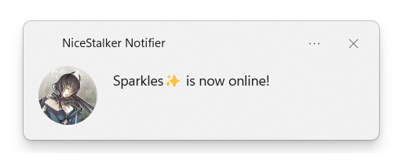

# NiceStalker

_"Day walker, night stalker."_

NiceStalker is a simple Discord bot designed to notify users when people become online or start activities on Discord. The project's name is a playful nod to [Night Stalker](https://www.dota2.com/hero/nightstalker), a character from the popular game Dota 2.

<p align="center">
  
</p>

## Features

:white_check_mark: **Real-time notifications:** NiceStalker keeps track of users' statuses and sends notifications whenever someone comes online on Discord.

:white_check_mark: **Activity tracking:** NiceStalker also notifies you when a monitored user starts playing a game or launches an activity.

:white_check_mark: **Customizable settings:** You can customize your notification preferences, including which users to monitor.

:white_check_mark: **Tray Option**: NiceStalker provides a tray icon functionality allowing you to run the app in the background and access it conveniently from the system tray. NiceStalker can also be stopped through the tray icon menu.

:white_check_mark: **Automatic startup:** If required, NiceStalker can automatically start up on system boot, ensuring that you never miss out on any important alerts.

:white_check_mark: **Easy-to-use interface for configuring the app** NiceStalker offers an intuitive interface to configure the bot's settings. You can easily adjust your notification preferences without the need to use any command-line commands directly.

## Installation

### Windows

1. Download the latest release from the [Releases](https://github.com/naghim/NiceStalker/releases) page.

2. Double-click the downloaded `.exe` file to install the application.

3. Start the application, configure the settings and press "Start". To automatically run the application on startup, check the corresponding checkbox.

### Linux

1. Download the latest `NiceStalker` binary from the [Releases](https://github.com/naghim/NiceStalker/releases) page.

2. Make it executable and run it:

```bash
chmod +x NiceStalker
./NiceStalker
```

3. Ensure the following system packages are installed (most desktop distros include these by default):
   - `libnotify` - for desktop notifications (`notify-send`)
   - `libappindicator3` - for the system tray icon (optional)

   **GNOME users:** GNOME does not display tray icons by default, so the tray icon will not appear
   and closing the window will quit the app until the _AppIndicator and KStatusNotifierItem Support_
   extension is installed and enabled. See [Troubleshooting](#the-tray-icon-does-not-appear).

### macOS

Currently, there is no standalone executable for macOS. You can still run NiceStalker using Python as described below.

### Using Python

#### Pre-requisites

Ensure that you have Python 3.12 or newer installed on your system.

#### Installation Steps

To install NiceStalker, follow these steps:

1. Clone the repository to your local machine.

```bash
git clone https://github.com/naghim/NiceStalker.git
```

2. Create and activate a virtual environment, then install the necessary dependencies.

```bash
python -m venv --system-site-packages .venv
source .venv/bin/activate      # Linux/macOS
.venv\Scripts\activate         # Windows
pip install -r requirements.txt
```

3. Ensure that you are logged into the Discord client.

4. _Optional:_ Configure the bot: see steps below.

5. Run the bot.

```bash
python -m nicestalker
```

Adding the `--discord` flag at the end will run the notifier headless (used by the "run on startup" option), without opening the configurator window.

### How it runs

NiceStalker runs as a single process with a system tray icon. The configurator window and the notifier share one event loop, so starting or stopping monitoring is instant and the window can be closed at any time - the app keeps running in the tray. Use the tray menu to reopen the settings, start/stop the notifier, or quit.

To verify that desktop notifications work on your system without waiting for a friend to come online:

```bash
python -m nicestalker --test-notify
```

This sends a single test notification and exits.

## Configuration

NiceStalker allows you to customize your notification preferences via a `config.json` file. The preferred way of configuration is through the GUI. However, you can also edit the `config.json` file manually.

The config file lives in your user config directory:

- **Windows:** `%LOCALAPPDATA%\naghim\NiceStalker\config.json`
- **Linux:** `~/.config/NiceStalker/config.json`
- **macOS:** `~/Library/Application Support/NiceStalker/config.json`

If a legacy `config.json` is found next to the app or in the current directory, it is migrated automatically on first launch.

For manual configuration, follow the steps below to set up your bot:

1. Create the `config.json` file in the location above (or let the app create it when you save from the GUI).

2. Use the following scheme to structure your `config.json` file:

```json
{
  "peopleToStalk": ["discord_username", "discord_displayname"],
  "peopleToIgnore": ["discord_username", "discord_displayname"],
  "runOnStartup": true
}
```

Replace `"discord_username"` and `"discord_displayname"` with the Discord usernames (users' unique identifier) or display names (which is shown to other users) of the individuals you wish to monitor. NiceStalker will notify you whenever these users become online.

> [!TIP]
> NiceStalker also supports partial matches for usernames and display names. If you provide a partial username or display name, NiceStalker will match it with any user whose username or display name contains the provided text.

If the `"peopleToStalk"` array is left blank, NiceStalker will notify you whenever **any** user becomes online.

There is also an option to blacklist users. Create another array in the `config.json` file named `"peopleToIgnore"` to add users to the list.

NiceStalker can also be configured to run on startup, to do so, add `"runOnStartup": true` to the config file.

## Troubleshooting

### The tray icon does not appear

**GNOME:** GNOME hides tray icons by default. Install the _AppIndicator and KStatusNotifierItem
Support_ extension, then log out and back in and enable it:

```bash
sudo apt install gnome-shell-extension-appindicator      # Debian/Ubuntu
sudo pacman -S gnome-shell-extension-appindicator        # Arch
sudo dnf install gnome-shell-extension-appindicator      # Fedora

gnome-extensions enable appindicatorsupport@rgcjonas.gmail.com
gnome-extensions info appindicatorsupport@rgcjonas.gmail.com   # should say State: ACTIVE
```

If it stays at `State: INITIALIZED` even though it is listed as enabled, GNOME's global extension
kill-switch is on. Clear it and enable again:

```bash
gsettings get org.gnome.shell disable-user-extensions          # if it prints "true":
gsettings set org.gnome.shell disable-user-extensions false
gnome-extensions enable appindicatorsupport@rgcjonas.gmail.com
```

Restart NiceStalker afterwards - it detects the tray when it starts.

### No notifications

Send a test notification:

```bash
python -m nicestalker --test-notify
```

On Linux this uses `notify-send`; make sure it is installed. On Windows, notifications are shown as
native toasts via the [`toasted`](https://pypi.org/project/toasted/) library.

### "No Discord token found"

Make sure the Discord desktop client is installed and you are logged in. NiceStalker reads the token
from the local Discord client, so the client needs to have been used at least once.

### Logs

Run NiceStalker from a terminal (`python -m nicestalker` or `python -m nicestalker --discord`) to see
log output, including the friends it found and every alert.
